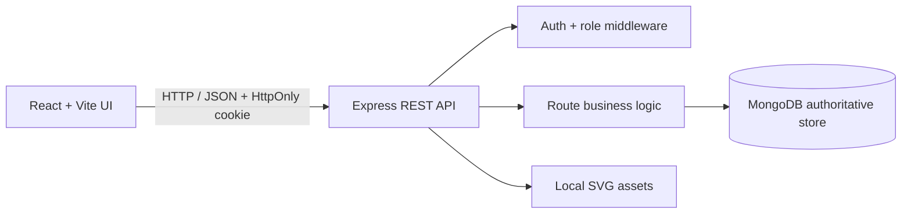

# Architecture

## Ownership and consistency
MongoDB owns all application records. MySQL is deliberately not configured as a second write target because the brief allows a documented trade-off if it would add complexity without a genuine benefit. Never implement uncontrolled dual writes for inventory. For a later relational reporting subsystem, use a transactional outbox in MongoDB and an idempotent consumer into a reporting-only MySQL schema.

## Security choices
Passwords use bcrypt hashes; sessions use signed JWTs in HTTP-only cookies; CORS is restricted to the configured client origin; Helmet and auth rate limiting are enabled; role checks run on protected API routes. Production deployment must set strong secrets, HTTPS, secure cookie settings, and a production email provider for reset flows.
