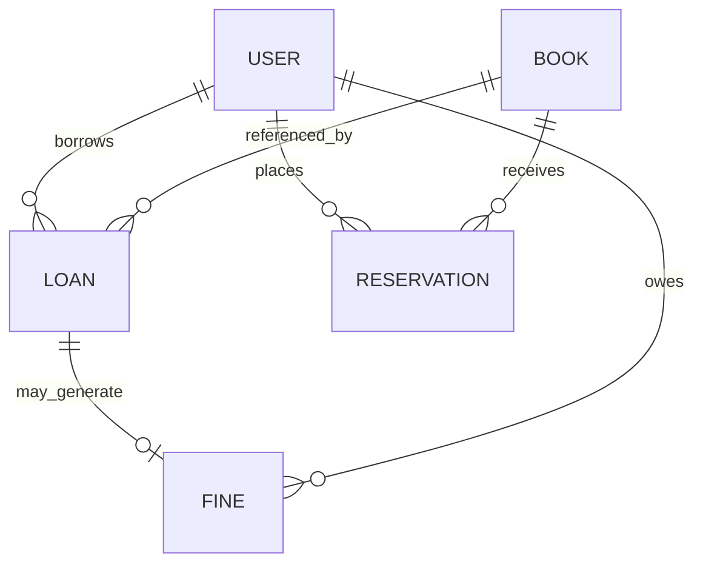

# Database schema (MongoDB)

- **User**: name, email (unique), passwordHash, role, status, membershipNumber, phone/address, avatar, membership expiry.
- **Book**: title, ISBN (unique sparse), authors, category, publisher, year, shelf, cover path, total/available copies, borrowing eligibility.
- **Loan**: book reference, member reference, issuing staff reference, issued/due/returned timestamps, status, fine amount.
- **Reservation**: book/member references, queue position, status, optional expiry.
- **Fine**: loan/member references, amount, paid amount, status, note. Payment is manual recording only.
- **Category**: unique category name and description.
- **AuditLog**: actor, action, entity type/id, details, IP and timestamps (model ready for extending route-level auditing).

## Relationships

## MySQL subsystem

MySQL is optional and owns `contact_messages`, the library's contact/support inbox. MongoDB remains authoritative for users, books, inventory, loans, reservations, and fines. This deliberate separation avoids duplicate authoritative records and unsafe cross-database dual writes. Apply `database/mysql-schema.sql` in MySQL and configure `MYSQL_HOST`, `MYSQL_PORT`, `MYSQL_USER`, `MYSQL_PASSWORD`, and `MYSQL_DATABASE`. If MySQL is not configured, library APIs still run, the health endpoint reports the optional subsystem as not configured, and contact submissions return HTTP 503 rather than claiming they were saved.
